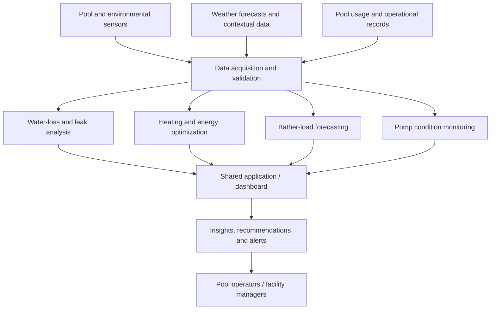

# Smart Swimming Pool Management System
### Edge-AI & IoT System for Intelligent Water Loss Analysis, Structural Leak Detection, and AI-Driven Resource Optimization


**Project ID:** J26–IT–380  
**Institution:** Sri Lanka Institute of Information Technology (SLIIT)  
**Project type:** Final-year undergraduate group research  
**Application domain:** Commercial swimming pools, hotels, resorts and recreational facilities  
**Status:** Research and development

> **Project scope:** This repository represents the **complete four-component group research project**, not an individual research component. Proposed functionality is identified separately from implemented and validated functionality.

## Overview

Managing a commercial swimming pool requires coordinated decisions about water conservation, heating, pool usage, and equipment maintenance. Conventional practices often depend on manual checks, fixed operating schedules, and reactive responses, which can result in undetected water loss, unnecessary energy use, inefficient resource allocation, and avoidable equipment downtime.

The **Smart Swimming Pool Management System** is a proposed integrated **IoT, machine-learning and Edge-AI** platform that combines monitoring, forecasting, anomaly detection, and operational decision support. The research aims to help pool operators make more informed decisions through a unified dashboard and component-specific alerts.

### Project objectives

- Investigate methods to distinguish **normal evaporation from abnormal water loss and possible structural leaks**.
- Explore **weather-aware heating strategies** to reduce avoidable energy consumption while maintaining suitable pool temperatures.
- Forecast **bather demand** to support more efficient planning of filtration, treatment, staffing, and related resources.
- Investigate **real-time pump condition monitoring**, abnormal vibration/cavitation detection, and predictive-maintenance decision support.
- Integrate the research outputs into a consistent, understandable **pool-management interface**.
- Evaluate each component against relevant baselines using real measurements or clearly documented experimental data.

## Visuals and Demonstration

Add screenshots, diagrams, and demo recordings when they are available and verified. Suggested locations:

| Visual | Suggested repository path |
|---|---|
| Overall system architecture | `docs/images/system-architecture.png` |
| Dashboard overview | `docs/images/dashboard.png` |
| Water-loss analytics | `docs/images/water-loss.png` |
| Heating optimization | `docs/images/heating.png` |
| Bather-load forecasting | `docs/images/bather-forecast.png` |
| Pump condition monitoring | `docs/images/pump-monitoring.png` |
| Demonstration GIF | `docs/images/demo.gif` |

**Overall conceptual architecture:**



*The diagram illustrates the intended research architecture; it does not claim that all integrations are already implemented.*

## Table of Contents

- [Overview](#overview)
- [Visuals and Demonstration](#visuals-and-demonstration)
- [Research Components](#research-components)
- [Integrated System Workflow](#integrated-system-workflow)
- [Technology Stack](#technology-stack)
- [Repository Structure](#repository-structure)
- [Prerequisites](#prerequisites)
- [Installation and Setup](#installation-and-setup)
- [Usage Examples](#usage-examples)
- [Evaluation and Validation](#evaluation-and-validation)
- [Features and Roadmap](#features-and-roadmap)
- [Contributing](#contributing)
- [Security, Privacy and Research Ethics](#security-privacy-and-research-ethics)
- [Limitations](#limitations)
- [Research Team](#research-team)
- [License](#license)
- [Acknowledgements](#acknowledgements)

## Research Components

The project comprises **four complementary research components**. Each addresses a different operational problem while contributing to the shared pool-management platform.

### 1. Intelligent Water-Loss Analysis and Structural Leak Detection

**Problem:** Pool water levels change because of evaporation, swimmer activity, refilling, and potential leaks. Automated top-up systems may conceal persistent water loss, making manual identification of a hidden leak difficult.

**Research direction:**
- Collect relevant water-level, flow, and environmental measurements.
- Estimate or model expected water loss under normal conditions.
- Compare observed losses against expected behaviour.
- Identify unusual patterns that may suggest structural or underground-pipe leakage.
- Provide actionable alerts for further inspection.

**Intended output:** Water-loss trends, abnormal-loss indicators, and possible leak alerts.

### 2. AI-Based Heating and Energy Optimization

**Problem:** Conventional pool heating may respond only to current water temperature without considering upcoming sunshine, weather changes, or operating requirements. This can result in unnecessary heater operation.

**Research direction:**
- Monitor pool-water temperature and relevant environmental conditions.
- Use weather forecasts and historical behaviour to estimate future temperature changes.
- Investigate predictive heating schedules or recommendations.
- Balance energy-saving goals with acceptable pool-temperature constraints.
- Compare the proposed approach with a defined conventional heating baseline.

**Intended output:** Temperature forecasts, heating recommendations, and energy-performance comparisons.

### 3. Bather-Load Forecasting and Resource Optimization

**Problem:** Pool demand changes across hours, days, and seasons. Fixed operational schedules may allocate filtration, water treatment, staffing, or other resources inefficiently.

**Research direction:**
- Examine historical usage, booking/occupancy, calendar, and weather-related factors where permitted and available.
- Forecast expected bather demand over a defined time horizon.
- Translate forecasts into resource-planning recommendations.
- Evaluate forecasting accuracy and the practical usefulness of recommendations.

**Intended output:** Predicted pool usage, demand trends, and resource-planning insights.

### 4. Pump Condition Monitoring and Predictive Maintenance

**Problem:** Circulation and filtration pumps can develop abnormal operating conditions that are difficult to detect through occasional manual inspections.

**Research direction:**
- Collect vibration measurements and optionally acoustic measurements from suitable sensors.
- Investigate signal preprocessing, time-domain and frequency-domain features, and machine-learning approaches.
- Explore real-time detection of abnormal operating conditions, including possible cavitation.
- Track condition trends to support maintenance decisions.
- Evaluate whether lightweight inference can run on an edge device.

**Intended output:** Pump condition indicators, anomaly notifications, and maintenance decision support.

> **Validation note:** An unusual vibration or sound pattern does not by itself establish a specific mechanical or hydraulic fault. Fault identification requires appropriately labelled experiments and independent evidence.

## Integrated System Workflow

1. **Acquire data** from pool sensors, environmental sources, operational records, and permitted external inputs.
2. **Validate and preprocess** measurements, handling missing values, noise, and inconsistent timestamps.
3. **Analyse each component** using appropriate statistical, machine-learning, optimization, or rule-based methods.
4. **Publish component results** through defined backend interfaces or data services.
5. **Present findings** through a shared dashboard with trends, forecasts, alerts, and recommendations.
6. **Evaluate results** against test scenarios and appropriate performance baselines.

The four components may use different data frequencies, algorithms, and validation procedures. A common application does not imply a single model is suitable for every task.

## Technology Stack

The following is the **intended technology direction**. Exact packages, versions, and integrations must be verified against the source code before they are described as implemented.

| Layer | Candidate technologies / approaches |
|---|---|
| Frontend | React and a modern JavaScript toolchain |
| Backend | Node.js / Express or the framework selected in the repository |
| Data storage | PostgreSQL or the database configured by the backend |
| Database tooling | Prisma if present in the repository |
| IoT devices | ESP32-class microcontrollers and component-specific sensors |
| ML development | Python and appropriate ML/data-processing libraries |
| Edge intelligence | Lightweight on-device processing and TinyML where feasible |
| Integration | HTTP APIs, device communication, and structured data exchange as implemented |
| Collaboration | Git and GitHub |

**Avoid assuming a technology is already installed:** the source files and dependency manifests are the authoritative reference.

## Repository Structure

A suggested organization for the integrated research repository is:

```text
RP_Planner_J26-IT-380/
├── frontend/                  # Shared user interface (if present)
├── server/                    # Backend application / API (if present)
├── components/                # Optional component-specific implementations
│   ├── water-loss/
│   ├── heating-optimization/
│   ├── bather-forecasting/
│   └── pump-monitoring/
├── ml/                        # Optional model training and evaluation
├── firmware/                  # Optional IoT device code
├── docs/
│   └── images/                # Diagrams and verified screenshots
├── tests/                     # Optional automated/integration tests
├── .gitignore
└── README.md
```

**This is a proposed layout, not a verified listing of existing files.** Retain the actual repository structure and update this section as development progresses.

## Prerequisites

Install the software relevant to the parts you intend to run:

- **Git** for cloning and version control.
- **Node.js and npm** compatible with the project's `package.json` files. Check the `engines` field, lockfile, and framework requirements for the exact version.
- **PostgreSQL** only if the backend currently requires it.
- **Python 3** and the packages declared by any committed ML services or training scripts.
- **ESP32 development environment**, supported board packages, and compatible sensors for hardware experiments.
- A modern browser for the web dashboard.

No exact runtime version is claimed until confirmed from the actual repository manifests.

## Installation and Setup

### 1. Clone the repository

```bash
git clone <YOUR_GITHUB_REPOSITORY_URL>
cd RP_Planner_J26-IT-380
```

Replace the placeholder with the real repository URL.

### 2. Set up the frontend (if `frontend/` exists)

```bash
cd frontend
npm install
npm run
```

`npm run` lists the scripts actually available in the package. If a `dev` script exists, start the frontend with:

```bash
npm run dev
```

Open the local URL printed in the terminal.

### 3. Set up the backend (if `server/` exists)

Open another terminal from the repository root:

```bash
cd server
npm install
npm run
```

If the server defines a `dev` script:

```bash
npm run dev
```

Otherwise use the actual start script provided by `server/package.json`.

### 4. Configure environment variables

If a component includes `.env.example`, copy it and fill in the values required by that component.

**macOS/Linux:**

```bash
cp .env.example .env
```

**Windows PowerShell:**

```powershell
Copy-Item .env.example .env
```

Run the copy command **inside the directory containing `.env.example`**. If no template exists, consult the corresponding component documentation rather than inventing environment variables.

**Never commit** `.env`, database passwords, private keys, access tokens, or other credentials.

### 5. Configure the database, if required

1. Start the database service used by the backend.
2. Create a development database.
3. Configure the connection string in the backend's local environment.
4. Run only the migration/client-generation commands supported by the committed schema and package scripts.
5. Verify that the backend can connect successfully.

### 6. Configure ML and IoT modules, when available

Component-specific setup will depend on the committed model files, Python dependencies, firmware, sensor wiring, and device communication method. Add a separate setup guide for each module as it becomes operational.

> **Setup accuracy:** The commands above are safe starting points for a typical Node-based repository, but they are not proof that every service or hardware module already exists. Verify each directory and script before running it.

## Usage Examples

### Start the application

In separate terminals, start the backend and frontend using their actual configured scripts. Then open the frontend's reported local address.

### Illustrative application workflow

```text
1. Pool operator opens the dashboard.
2. Available sensor readings and operational data are displayed.
3. Water-loss analysis flags unusual loss patterns.
4. Heating analysis provides forecast-aware recommendations.
5. Bather-load analysis estimates upcoming pool demand.
6. Pump monitoring highlights abnormal operating behaviour.
7. The operator reviews alerts and takes appropriate action.
```

*This is a target user journey, not a claim that every screen or feature is already live.*

### Example conceptual data record

The following is an **illustrative schema**, not a documented production API request:

```json
{
  "timestamp": "2026-10-28T10:00:00Z",
  "pool_id": "demo-pool-01",
  "measurements": {
    "water_level_cm": 145.2,
    "water_temperature_c": 27.4,
    "ambient_temperature_c": 24.1,
    "pump_vibration_rms": 0.18
  },
  "source": "example-data"
}
```

Actual data fields, units, validation rules, and endpoints should be documented once implemented.

## Evaluation and Validation

Each research component needs its own experimental design and baseline.

| Component | Potential evaluation measures |
|---|---|
| Water-loss and leak analysis | Detection precision/recall, false-alarm rate, missed-event rate, performance across evaporation conditions |
| Heating and energy optimization | Energy consumption relative to a baseline, temperature constraint violations, comfort/operational compliance |
| Bather-load forecasting | MAE, RMSE, and error across different demand periods |
| Pump monitoring | Precision, recall, F1-score, confusion matrix, false alarms, inference latency and edge-device resource use |
| Integrated platform | Data delivery reliability, response time, alert behaviour, usability, and end-to-end test results |

Publish performance figures only after experiments are completed. Clearly distinguish simulated data, public benchmark datasets, and real commercial-pool measurements.

## Features and Roadmap

### Research scope defined

- [x] Identify four complementary research components.
- [x] Establish the proposed integrated IoT/AI system concept.
- [x] Document the initial system goals and research directions.

### Planned development and validation

- [ ] Finalize hardware and software architecture for all four components.
- [ ] Implement reliable sensor acquisition and data storage.
- [ ] Implement water-loss estimation and potential leak detection.
- [ ] Implement forecast-aware heating analysis or optimization.
- [ ] Implement bather-load prediction and resource recommendations.
- [ ] Implement and validate pump-condition anomaly detection.
- [ ] Evaluate edge-device processing and deployment where feasible.
- [ ] Integrate outputs into the shared dashboard.
- [ ] Implement and verify alerts and reporting.
- [ ] Add automated tests and integration tests.
- [ ] Conduct controlled experiments and baseline comparisons.
- [ ] Document performance, limitations, and deployment requirements.
- [ ] Prepare the final research demonstration and report.

> Checkboxes reflect **documented scope**, not an audit of repository commits. Update them to match actual completed and tested work.

## Contributing

This is a collaborative academic research project. Approved team members and contributors are welcome to improve code, documentation, tests, and reproducibility.

1. Check existing GitHub issues and discuss significant changes with the team.
2. Create a feature branch for the intended work.
3. Keep commits focused and write meaningful commit messages.
4. Include setup changes, screenshots, or test evidence when relevant.
5. Do not upload passwords, private research data, or partner-organization information.
6. Open a pull request describing the change and how it was tested.
7. Request a review before merging shared or cross-component changes.

Suggested branch naming:

```text
feature/water-loss-dashboard
feature/heating-forecast
feature/bather-load-model
feature/pump-monitoring
fix/api-validation
docs/readme-update
```

## Security, Privacy and Research Ethics

- Keep credentials and secrets out of version control.
- Restrict access to sensitive operational data and management controls.
- Obtain permission before collecting information from hotels, facilities, staff, or visitors.
- Use anonymized or synthetic demonstration data where appropriate.
- Clearly identify third-party datasets and comply with their licenses and usage terms.
- Treat anomaly alerts as decision-support signals requiring verification.
- Do not connect experimental control logic to operational heaters or pumps without appropriate safeguards and authorization.

## Limitations

- This is a **research prototype**, not a certified industrial pool-control or safety system.
- Each component requires independent implementation, evaluation, and validation.
- Prediction and detection performance depend on representative data and reliable labels.
- Apparent abnormal water loss may have causes other than a structural leak.
- Heating recommendations must respect temperature, equipment, and safety constraints.
- Forecast-based resource recommendations require operational validation before automation.
- Pump vibration/acoustic anomalies do not uniquely prove cavitation or a specific fault.
- Exact failure dates or remaining useful life should not be claimed without appropriate longitudinal evidence.
- External weather feeds, network connectivity, and sensor availability may affect system performance.

## Research Team

**Project:** Edge-AI & IoT System for Intelligent Water Loss Analysis, Structural Leak Detection, and AI-Driven Resource Optimization  
**Project ID:** J26–IT–380  
**Institution:** Sri Lanka Institute of Information Technology (SLIIT)

The four-member research team works across these research areas:

| Research area | Responsibility |
|---|---|
| Water-loss analysis | Intelligent water-loss monitoring and possible structural leak detection |
| Heating optimization | AI-assisted heating schedules and energy-efficiency analysis |
| Resource forecasting | Bather-load prediction and resource planning |
| Pump monitoring | Vibration-based condition monitoring, possible cavitation detection, and maintenance support |

Add the team members' names, GitHub usernames, and supervisor details after confirming the preferred public attribution.

## License

No open-source license is asserted by this README. The team should choose an appropriate license and add a `LICENSE` file if public reuse or redistribution is intended.

## Acknowledgements

We acknowledge the guidance and support of the academic staff and supervisors at the Sri Lanka Institute of Information Technology (SLIIT), the contributions of all four research team members, and the academic and technical resources supporting this research. We also appreciate the insights of industry participants who may provide feedback or support authorized testing.

---

**Maintained by:** J26–IT–380 Research Team  
**Last documentation update:** October 2026  
**Development stage:** Research and prototyping
